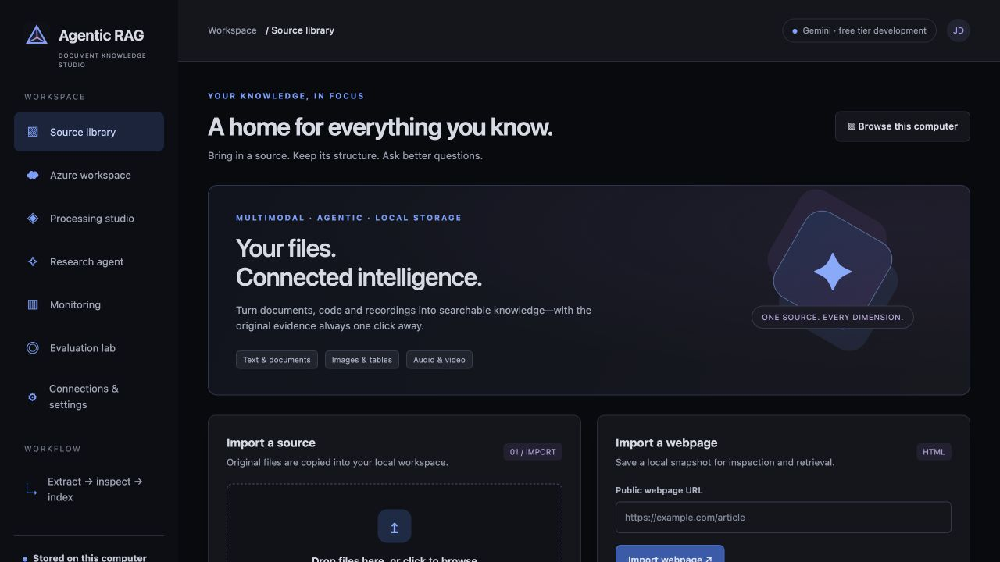
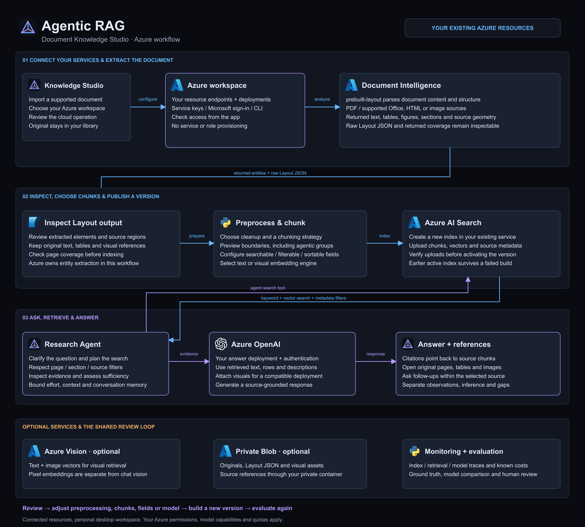
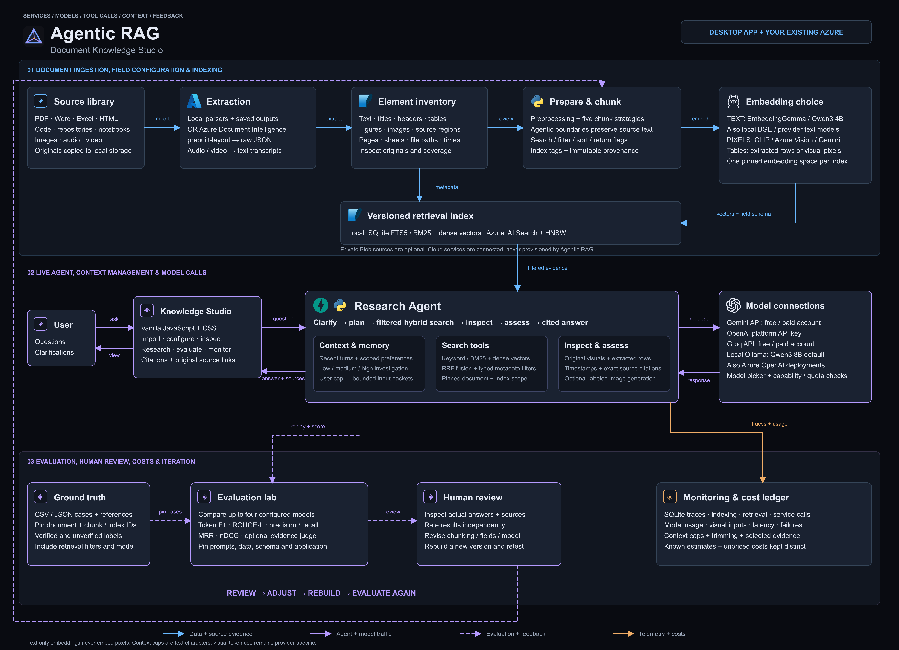

<h1 align="center">Agentic RAG</h1>

<strong>Document Knowledge Studio</strong> Bring your documents. Explore what is inside. Ask better questions.

📄 Documents &nbsp; · &nbsp; 📊 Tables & charts &nbsp; · &nbsp; 🖼️ Images &nbsp; · &nbsp; 🎧 Recordings &nbsp; · &nbsp; 💻 Code

Your notes, reports, spreadsheets and recordings hold more than paragraphs. They hold diagrams, numbers, screenshots, source code and the context around them. Agentic RAG turns a working document into a knowledge workspace you can inspect, search and have a conversation with—with links back to the original evidence.

## From “where did I put that?” to “show me the evidence”

**Bring something you want to understand.** Upload a PDF, Word document, spreadsheet, image or recording. Import a webpage or a software project folder. Choose a working source and keep the original alongside it.

**See what the app found.** Explore text, headings, tables, figures, images and transcript segments before you build your index. Open the original page, inspect a table or follow a recording timestamp. You get to review the extraction rather than guess what the model saw.

**Choose how it becomes knowledge.** Pick preprocessing and chunking options, preview the chunks and build an index. Agentic chunking asks a model to organize source units into topic groups while preserving the source text and order.

**Start a conversation.** The research agent clarifies your scope, searches the selected document, inspects the evidence and answers with citations. Follow a citation to its source; ask a follow-up while keeping the conversation in context.

> “Explain this chart and show the page it came from.”  
> “Which rows support that conclusion?”  
> “Summarize the discussion and link me to the relevant recording segment.”  
> “Where is this behavior implemented in the project?”

These are prompts to try with your own content. The answer depends on the source, extraction quality and selected model.

## Two ways to work with visual documents

| Choose | What happens | Useful when |
|---|---|---|
| **Describe visuals as text** | Available image/chart descriptions and extracted table data join the text index. Matching results keep their original visual references. | You want text-based retrieval or are using a text-only answer model. |
| **Use multimodal embeddings** | Image/chart/table-preview pixels and text are indexed together. A compatible answer model can inspect the retrieved visuals directly. | The visual itself carries information you want the model to see. |

You choose the embedding engine and answer model separately. Text-only models can discuss extracted rows and existing descriptions; direct image understanding needs an image-capable model. Audio and video become searchable transcripts with links to the original recording.

## Your desktop, or your existing Azure workspace

**Desktop workflow:** import → extract → inspect → choose chunks → build an index → chat. Run a local Ollama model, or connect Gemini, OpenAI platform or Groq. Ollama starts with **Qwen3 8B**; you can choose other installed models. Gemini and Groq support keys from free or paid accounts, subject to your provider's access and limits.

**Azure workflow:** connect your existing services from the app, then let **Azure Document Intelligence `prebuilt-layout`** extract the document. Inspect the returned elements and raw JSON, choose preprocessing and chunking, and publish a new index inside **your Azure AI Search service**. Connect your **Azure OpenAI deployment** for the conversation.

The agent uses the Azure index as a tool: **keyword + vector search**, narrowed by metadata such as page, section or source. Retrieved text, table data and supported original visuals ground the answer. Optional Azure Vision provides pixel embeddings; optional private Blob Storage keeps cloud source references. Monitoring and evaluation work with Azure indexes too.

The app connects resources you already own. You review cloud operations before files are sent or an index is published. [Explore Azure setup →](docs/azure.md)

## Make it yours, then make it better

- **Model choice:** save several connections and compare models without rebuilding your whole workspace.
- **Search control:** choose hybrid, keyword or vector retrieval; use metadata filters to focus the evidence.
- **Context and memory:** choose investigation effort and context limits, keep follow-ups in scope, and inspect the document-scoped memory.
- **Monitoring:** watch extraction, indexing, retrieval and model activity. See failures, usage and known cost estimates; unknown prices stay visible.
- **Evaluation lab:** bring a ground-truth dataset, compare answers and retrieval metrics, review the sources yourself, then change a setting and try again.

## Try your first conversation

1. Run **`setup.command`** once for a fresh installation, then **`start.command`**. Open [Document Knowledge Studio](http://127.0.0.1:8020).
2. Add a model in **Connections & settings**, or test the default local Ollama profile. For Azure, also connect your services in **Azure workspace**.
3. Import a source in **Source library**. In **Processing studio**, choose your workflow and retrieval mode, inspect extraction, preview chunks and build the index.
4. Open **Research agent**, ask a question, clarify the scope and explore the answer's source references.

Your library, conversations and traces are stored on your computer. Selected files or retrieved content are sent to cloud services when you choose those services. Local storage alone does not make every configured workflow offline.

## A look inside

[Zoom into the architecture](resources/images/agentic-rag_architecture.svg) · [Editable architecture](docs/diagrams/agentic-rag_architecture.drawio) · [Editable Azure flow](docs/diagrams/azure-workflow.drawio)

For setup, implementation details, supported-format limits and test evidence, head to the [backend README](app/README.md), [frontend README](static/README.md), [model guide](docs/providers.md) or [verification notes](docs/verification.md).
