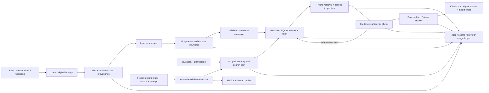

# Architecture

Agentic RAG uses FastAPI, a same-origin browser interface and workspace-local SQLite. No database service, container stack or cloud file store is required.

| Component | Responsibility |
|---|---|
| `backend/src/app/core/store.py` | Local JSON records, version IDs, assets, SQLite vectors/FTS and event storage |
| `backend/src/app/ingestion/extraction.py` | Native and optional vision extraction; media transcription; table/chart previews; original locations |
| `backend/src/app/ingestion/indexing.py` | Preprocessing, five chunking strategies, validated agent plans, local/cloud embeddings, atomic activation and hybrid retrieval |
| `backend/src/app/integrations/providers.py` | Native Gemini/Responses adapters, encrypted credentials, call budgets and usage/cost ledger |
| `backend/src/app/agents/research.py` | Clarification, scoped memory, search planning, bounded evidence passes, citations and optional illustration generation |
| `backend/src/app/agents/evaluation.py` | Dataset validation, immutable benchmarks, pinned comparison snapshots, metrics and optional judge |
| `backend/src/app/main.py` | ASGI application composition and route registration |
| `backend/src/app/api/` | Thin HTTP routes, response shaping and loopback policy |
| `backend/src/app/services/` | Source imports, connection tests, jobs and monitoring workflows |
| `frontend/` | Responsive library, processing inspector, research chat, monitoring, evaluation and connection UI |

Index builds write to a new index ID and activate only after completion. Extraction revisions retain their own assets, so later processing cannot replace a historical index's evidence. Every visual gets a dedicated vector. Dimensions and embedding configuration are pinned; a query cannot silently use a different embedding space. Local CLIP maps image/text inputs to one space; local BGE is a text-only alternative. Cloud query embeddings use the saved embedding configuration with the current credential for the same connection.

The agent does not execute code or navigate the web during research. Its source tools are limited to the pinned local document/index. User guidance, memories and retrieved documents are contextual data, with evidence rules above them. Citations are validated against the supplied evidence IDs; semantic claim support still requires evaluation and review.

Background operations run independently of the browser, with two bounded local job workers. Cooperative cancellation stops before the next model call/stage; it cannot retract an in-flight cloud request. Interrupted jobs are marked explicitly on actual server startup, not when a module is imported. Restarting the app does not resume a partially completed operation automatically.

Local semantic and CLIP text encoders split long inputs using their actual tokenizer and aggregate all sub-packets rather than silently truncating them. This controls the encoder window but changes long-text representation; retrieval quality should be established with the user's benchmark. The default BGE model is optimized for English. Gemini embeddings or another supported configuration may suit multilingual data better; evaluate with representative queries.

## Azure adapters

`azure_auth.py` manages explicit Microsoft device-code sign-in and OS-encrypted token caching, or an existing CLI identity. `azure_cloud.py` manages encrypted service profiles, bound operation plans, service-call accounting, versioned Search publication, scoped cloud retrieval, native Azure Vision embeddings and optional private Blob publication. `azure_layout.py` submits `prebuilt-layout` once, polls a validated same-resource URL, retains raw JSON and maps returned entities into the common inventory. Local PDF rendering only previews/crops Azure-provided geometry.

Pipeline configuration selects extraction/index backends; old local configurations default to local. Azure indexes retain pinned resource identities and chunk snapshots. Retrieval never falls back from Azure to local on a cloud failure. The same agent and evaluation paths call the selected index backend. Cloud costs are recorded alongside model usage, with shared Search capacity and unconfigured storage costs explicitly excluded from per-run estimates. See [Azure workspace](azure.md).

## Provider connections

`model_catalog.py` supplies four primary provider choices and starter IDs, plus Azure OpenAI. `providers.py` uses native Gemini, OpenAI/Azure Responses, Groq Chat Completions and local Ollama `/api/chat`. Model inventory and connection tests remain separate from inference access and user-declared billing tier. Local model metadata is checked for completion/vision support, declared context and cloud routing before generation. Research packing accounts for local UTF-8 text bounds as well as character caps. See [model setup](providers.md).
